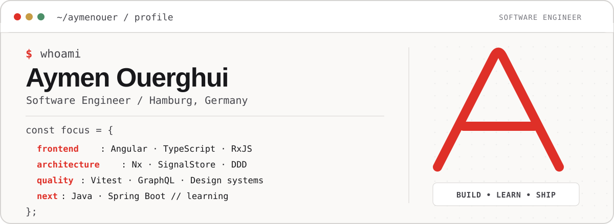
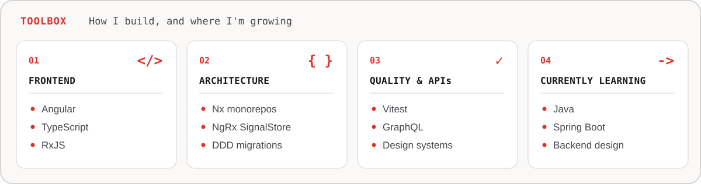
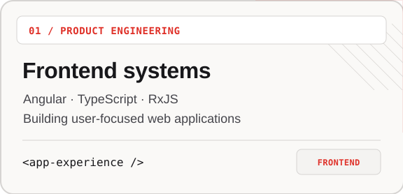
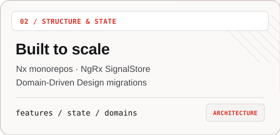
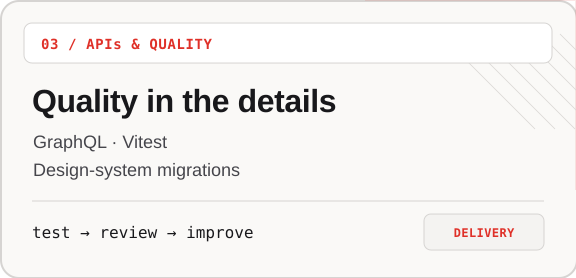
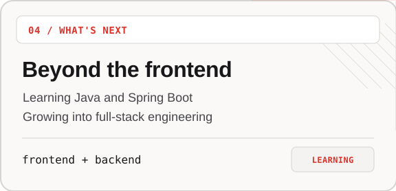
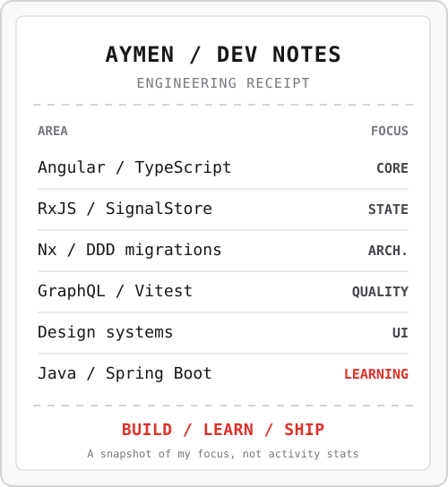

<picture>
  <source media="(prefers-color-scheme: dark)" srcset="assets/terminal-dark.svg">
  
</picture>

hey, I'm **Aymen**. I'm a **Software Engineer** based in Hamburg, Germany, working on web applications at **Immomio**. My day-to-day is **Angular**, **TypeScript**, and the things that make bigger frontend codebases work: architecture, predictable state, reusable UI, and testing.

I like turning complicated product requirements into interfaces that feel simple. These days, I'm also learning **Java and Spring Boot** so I can contribute further across the stack.

**[LinkedIn](https://www.linkedin.com/in/aymen-ouerghi-249632146/)** &nbsp;·&nbsp; **[GitHub](https://github.com/aymenouer)**

 

<picture>
  <source media="(prefers-color-scheme: dark)" srcset="assets/stack-dark.svg">
  
</picture>

### What I work on

My professional work is mostly in private company repositories. Here's what I spend my time building and improving — without pretending those projects are public:

  <picture><source media="(prefers-color-scheme: dark)" srcset="assets/tile-frontend-dark.svg"></picture>
  <picture><source media="(prefers-color-scheme: dark)" srcset="assets/tile-architecture-dark.svg"></picture>

  <picture><source media="(prefers-color-scheme: dark)" srcset="assets/tile-quality-dark.svg"></picture>
  <picture><source media="(prefers-color-scheme: dark)" srcset="assets/tile-learning-dark.svg"></picture>

### What's next

I'm building up my backend skills with **Java + Spring Boot** alongside my Angular experience. The goal is to ship complete, maintainable applications — from interface and state management to APIs, persistence, and tests.

As I publish new personal projects, I'll add them here. I prefer showing real work over filling a profile with placeholder projects.

### My development receipt

  <picture>
    <source media="(prefers-color-scheme: dark)" srcset="assets/receipt-dark.svg">
    
  </picture>

Hamburg, Germany &nbsp;·&nbsp; Software Engineer &nbsp;·&nbsp; Angular / TypeScript &nbsp;·&nbsp; Java + Spring Boot (learning) Original SVG artwork, optimized for GitHub light and dark themes.

